# CK Parrot —— 中文优先的 macOS 本地会议转写与 AI 助手

**简体中文** | [English](#english)

> **基于 [Parrot](https://github.com/turantekin/Parrot)（作者 turantekin / Uygar，GPL-3.0）二次开发。**
> 维护者：**CKNB**（[github.com/CKNB888](https://github.com/CKNB888)）。仓库：<https://github.com/CKNB888/ck-parrot>
> 包标识 `io.github.cknb6.ckparrot`，可与上游 Parrot 同时安装。

## 简介
macOS 原生（SwiftUI）会议工具：同时录制系统音频和麦克风，**在本机实时转写**（WhisperKit），通话中由 AI 助手（Parrot 原有的实时 Copilot，支持 Ollama / OpenAI 兼容接口等）结合你的文档给出提示，会后可导出 Markdown / TXT / SRT。

- 系统要求：macOS 14+，Apple Silicon
- 界面：简体中文为开发语言（zh-Hans），保留 English

## 界面截图

以下均为 CK Parrot 在 GitHub macOS 机器上实际渲染的界面（简体中文界面，示例通话内容为英文演示数据）。英文界面截图见 [docs/screenshots/en](docs/screenshots/en)。

| | |
|---|---|
| 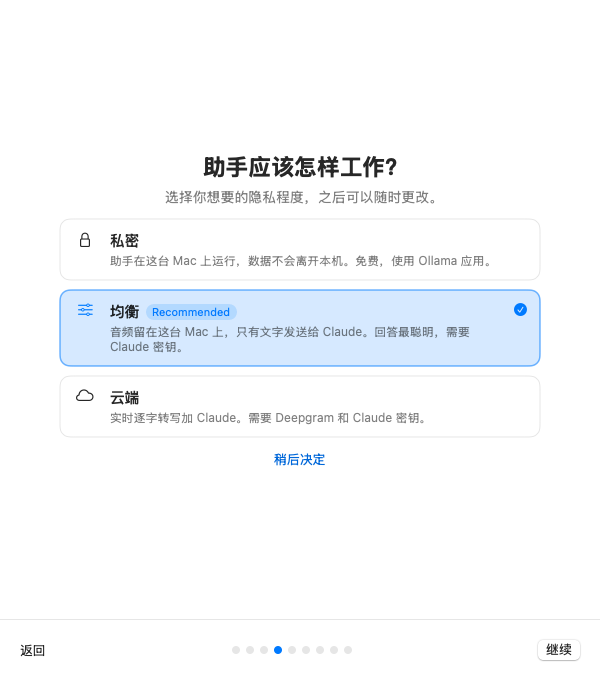<br>选择助手工作方式：私密 / 均衡 / 云端 | <br>下载本机语音模型，国内自动走镜像 |
| 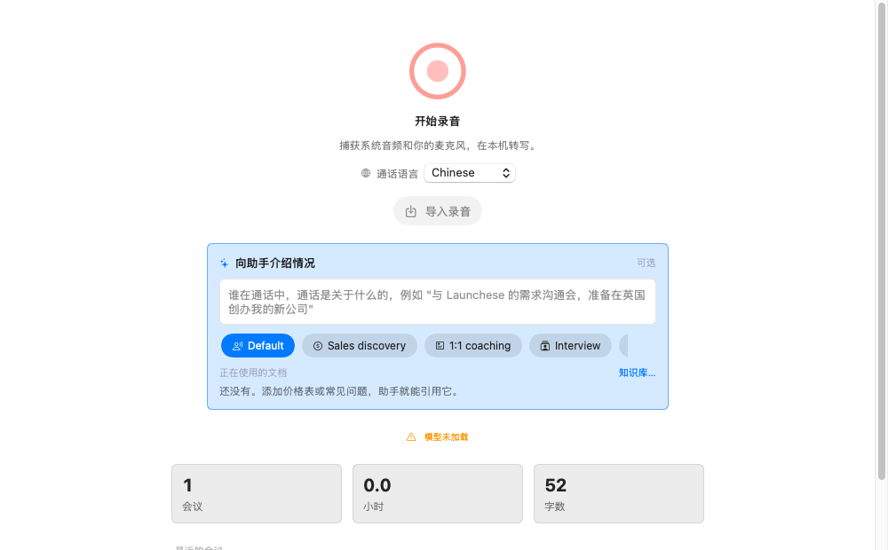<br>首页：一键开始录音，选择通话语言 | 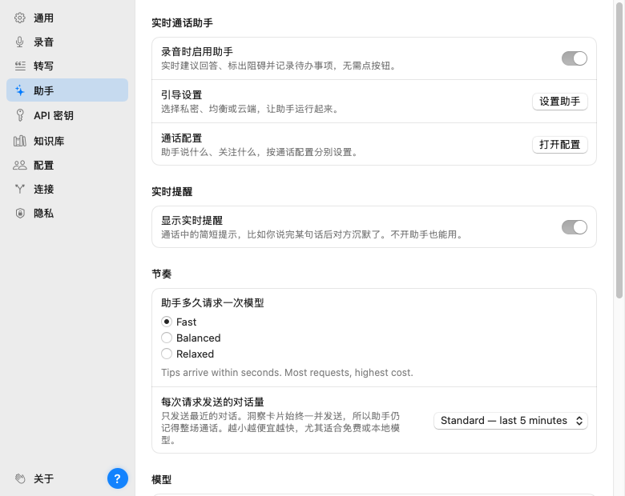<br>设置实时通话助手 |
| 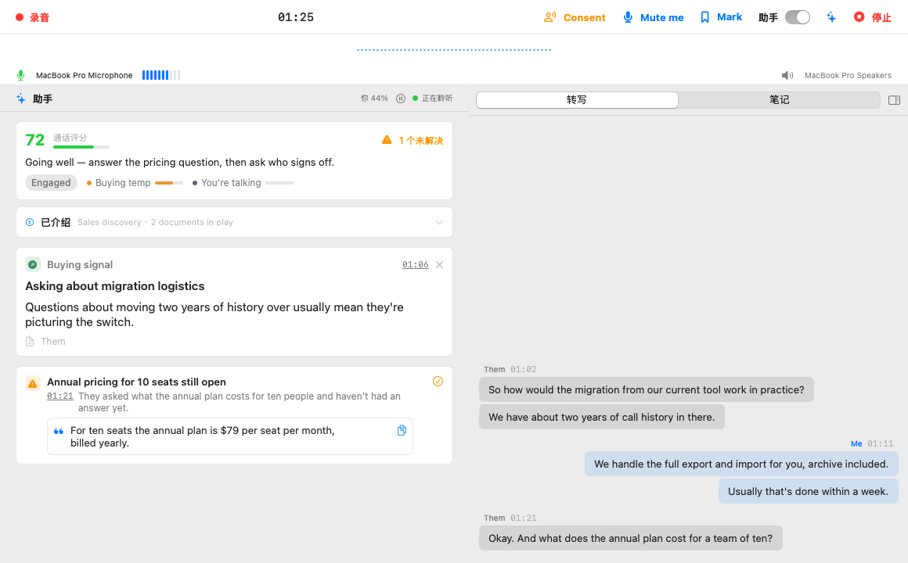<br>通话中：左侧助手卡片，右侧实时转写 | <br>助手悬浮窗：建议回答随时可复制 |
| <br>会后：会议信息与参会人 | <br>自动生成复盘报告与评分 |
| 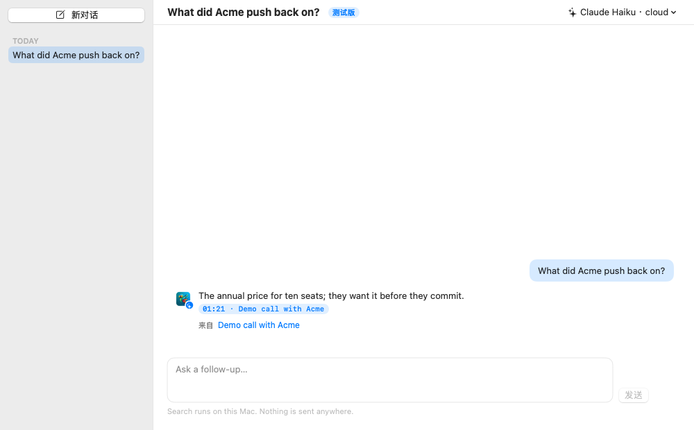<br>问问 Parrot：搜索你的所有通话 | 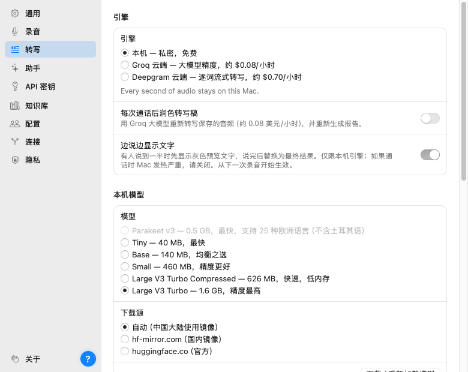<br>转写引擎与模型下载源 |
| 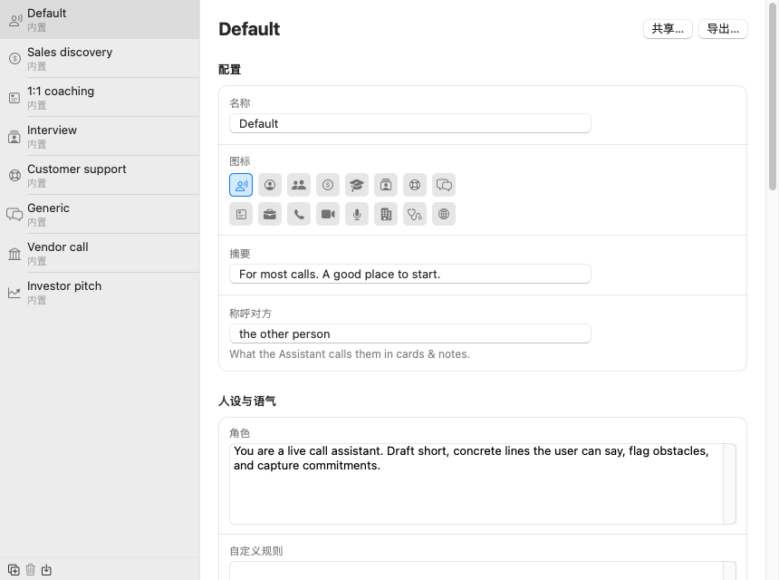<br>按通话类型配置助手 | 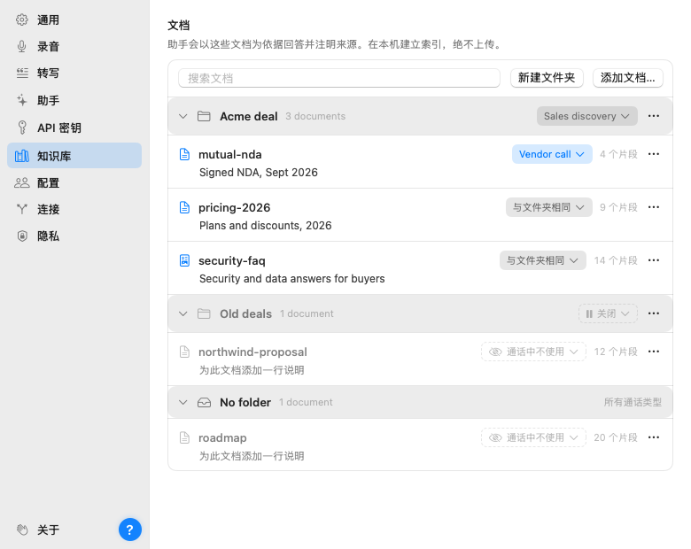<br>知识库：让助手引用你的文档 |
| 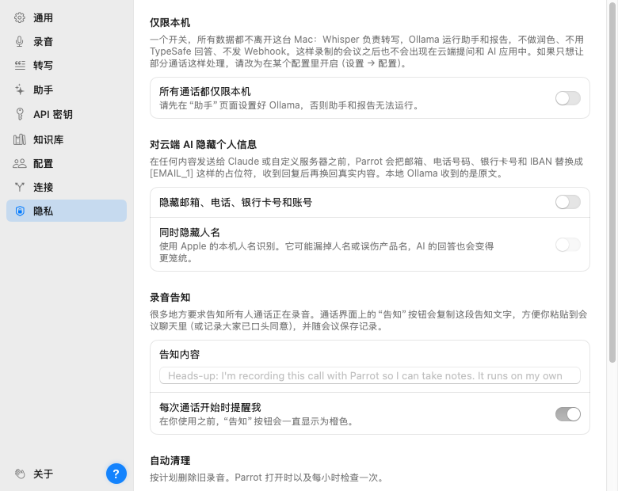<br>隐私：仅限本机、隐藏个人信息 | 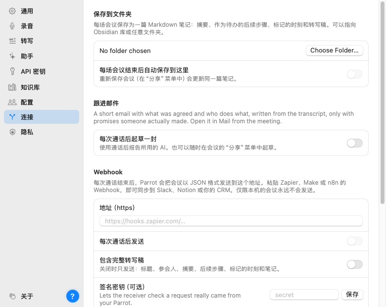<br>连接：保存笔记、Webhook、跟进邮件 |
| 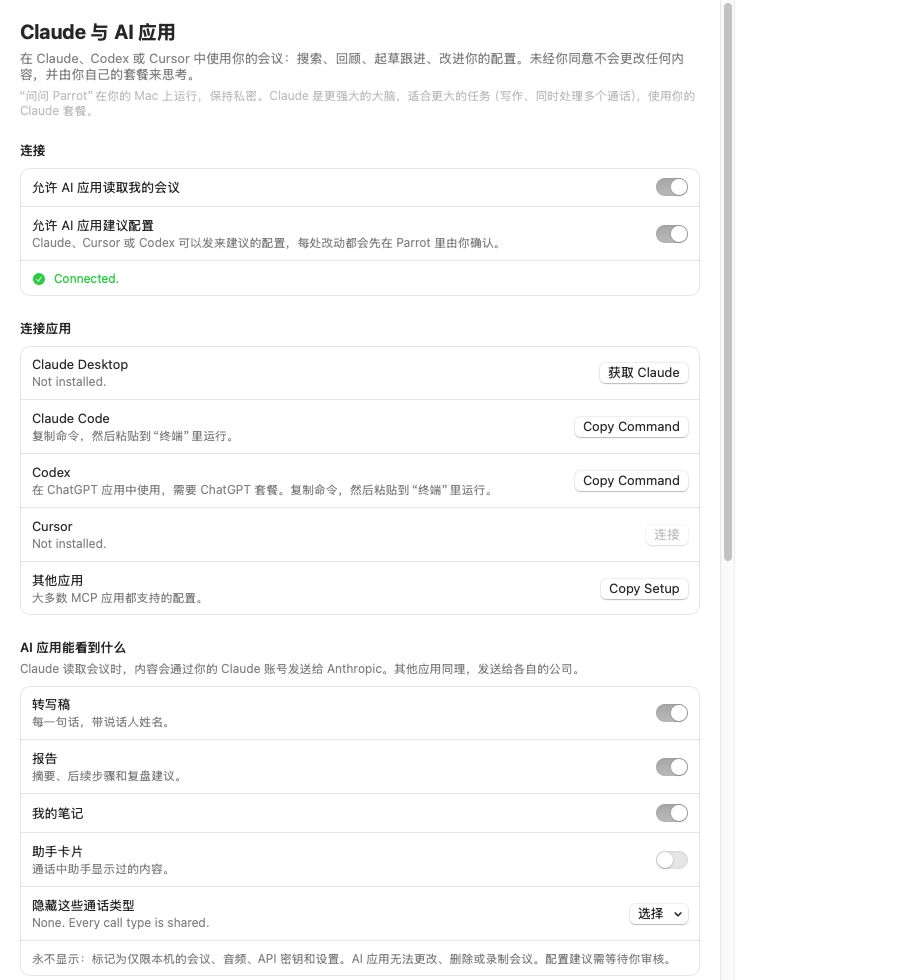<br>在 Claude / Cursor 中使用你的会议 |  |

## 使用教程


🎬 完整视频：[中文视频](https://github.com/CKNB888/ck-parrot/releases/download/v1.0.0/ck-parrot-tutorial-zh.mp4) · [English video](https://github.com/CKNB888/ck-parrot/releases/download/v1.0.0/ck-parrot-tutorial-en.mp4)

1. **安装**：在 [Releases](https://github.com/CKNB888/ck-parrot/releases) 下载 `.dmg` 或 `.pkg`。首次打开请右键 → 打开，或执行 `xattr -cr "/Applications/CK Parrot.app"`。
2. **授予权限**：按引导授予麦克风、“屏幕与系统录音”权限（日历可选）。
3. **选择助手方式**：私密（本机 Ollama）、均衡（音频留本机，文字发给 Claude）或云端。
4. **下载语音模型**：中文建议选 Large V3 Turbo；下载源默认自动，中国大陆走 hf-mirror.com 镜像。
5. **开始录音**：首页点「开始录音」，选择通话语言；腾讯会议、钉钉等开会时会自动检测到通话。
6. **通话中**：右侧实时转写，左侧助手卡片给出建议回答、待回答问题和待办事项，可一键复制。
7. **会后**：查看摘要、复盘报告和评分，导出 Markdown / TXT / SRT，或用「问问 Parrot」搜索过往通话。
8. **个性化**：在设置里配置通话类型、知识库文档、隐私（仅限本机、隐藏个人信息）和连接（Webhook、笔记文件夹）。

## v1.0.0 主要改动
- 更名 CK Parrot，新包标识，可与上游共存
- **中文优先**：开发区域 zh-Hans；系统语言为中文或未知时，转写语言默认「中文」
- **繁转简**：中文转写结果自动从繁体转换为简体（ICU Hant-Hans）
- 系统权限弹窗（麦克风 / 屏幕录制 / 系统录音 / 日历 / 提醒事项）全部中文
- 关闭指向上游的 Sparkle 自动更新（移除上游 feed 与公钥）
- 稳定性：数据库打开失败不再启动即崩（自动备份旧库并重建 / 退回内存模式）；引导页越界崩溃修复
- 术语统一（转写、服务商…），见 [docs/i18n-glossary.zh-CN.md](docs/i18n-glossary.zh-CN.md)
- 继承中文版修复：#146 推理模型截断自动重试、语言横幅截断等

## 安装
从 [Releases](https://github.com/CKNB888/ck-parrot/releases) 下载 `ck-parrot_*_macOS_arm64.dmg`。构建为 ad-hoc 签名、未公证：
首次请右键 → 打开，或执行 `xattr -cr "/Applications/CK Parrot.app"`。然后在 系统设置 → 隐私与安全性 授予麦克风与“屏幕与系统录音”权限。

**中文转写建议**：在引导或设置中选择 Large V3 Turbo（或其压缩版）模型，`base` 模型对中文效果较差；语言选择「中文」。

## 从源码构建
```bash
brew install xcodegen && xcodegen generate
make bundle CONFIG=release SIGN_IDENTITY=-
```

## 许可证
GPL-3.0（见 [LICENSE](LICENSE)）。上游版权归 Parrot 原作者所有；修改部分 © CKNB。

---

## English
**CK Parrot** is a Chinese-first fork of [Parrot](https://github.com/turantekin/Parrot) (GPL-3.0), maintained by **CKNB** ([github.com/CKNB888](https://github.com/CKNB888)). Bundle id `io.github.cknb6.ckparrot`; installs alongside upstream. Changes: zh-Hans development region, Chinese transcription default with Traditional→Simplified conversion, Chinese permission prompts, upstream Sparkle feed removed, crash-safe store fallback. Ad-hoc signed: run `xattr -cr "/Applications/CK Parrot.app"`. Upstream docs: [README.en.md](README.en.md).
